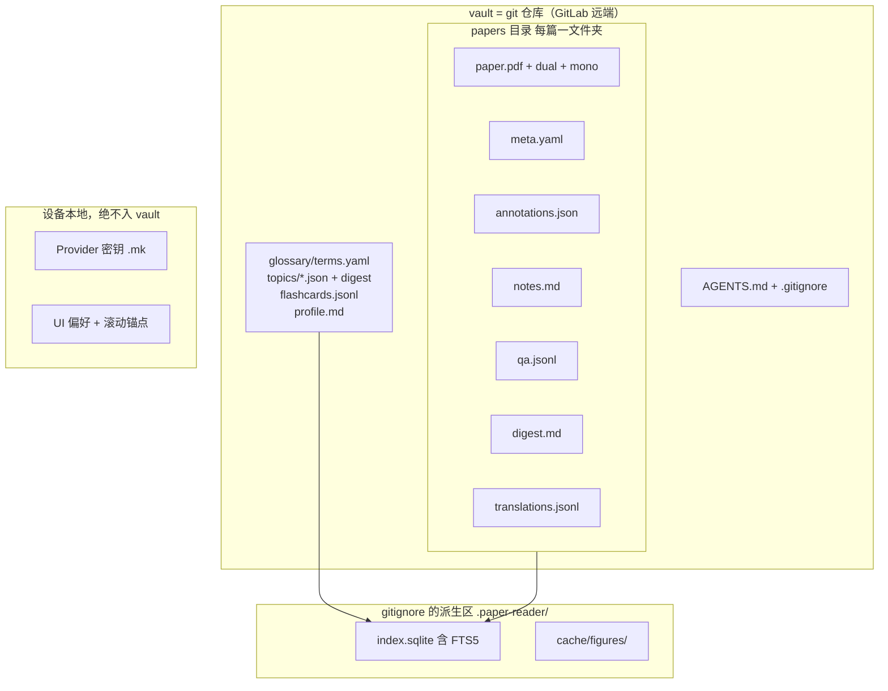
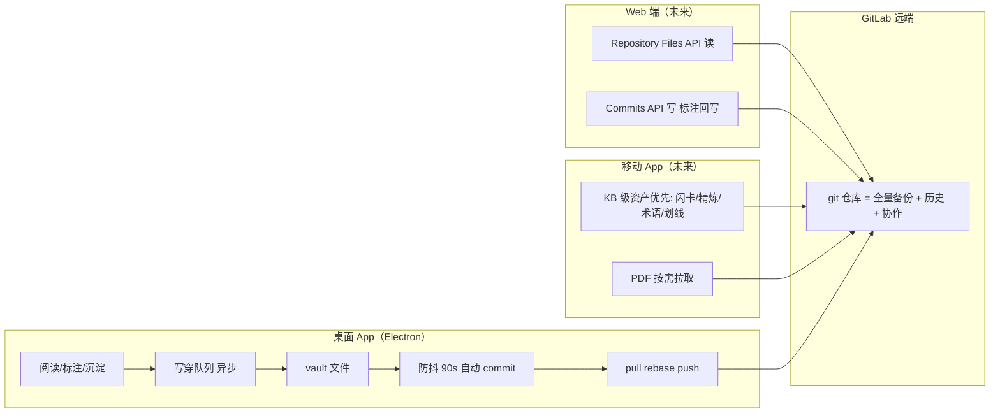

# 论文资产与沉淀产物的存储边界设计

日期：2026-11-08

这份设计回答一个问题：科研人员的论文资产（PDF、译文）和沉淀产物（划线、笔记、问答、精炼、术语、闪卡）应该存在哪里、什么进云端、什么可以丢。结论一句话：**文件即事实源，Git 即传输层，SQLite 降级为可丢弃重建的索引**。每篇论文一个人类可读的文件夹，全部资产进 Git 远端（GitLab，可选 LFS），App 死了资产还在，换设备 clone 即用。

设计基于三路调研：本仓库存储现状（16 张表 + 文件缓存的全量地图）、科研人员产品工作流（导入→阅读→标注→沉淀→复习→导出全链路）、九个开源实现对标（Zotero、Obsidian、Logseq、Readest、Sioyek、Anytype、Notesnook、Yjs/Automerge、Git-LFS）。

---

## 一、用户画像与使用场景

六类场景，各自依赖不同的价值轴。后续每一项存储决策都必须能追溯到至少一个场景。

| 场景 | 描述 | 关键价值轴 | 对存储的直接要求 |
|---|---|---|---|
| 下午读一篇 | 核心场景：导入→对照阅读→划线提问→沉淀 | 找得到 | 阅读中高频小写入不能拖慢 UI；划线秒回 |
| 写综述回溯 | 「我记得某篇论文有个对比论证」→ 全库检索 | 找得到 | 跨论文全文检索必须覆盖**译文**和问答，不只是标题 |
| 组会分享 | 导出翻译版 PDF、精炼笔记给同事 | 接得上 | 精炼里的 【H7】【N2】【Q5】 引用链任何时候点都能跳回原文 |
| 多设备 | 实验室台式机读，笔记本标，通勤手机复习 | 带得走 | KB 级沉淀资产（闪卡/精炼/术语）全端同步；PDF 懒加载 |
| 五年资产 | 博士期间的全部积累 | 丢不了 | 文件即事实源 + Git 历史；App 停更后资产仍可用任何工具打开 |
| 师门协作 | 师兄弟共用术语表、互相看笔记 | 接得上 | vault 是普通 git 仓库，AGENTS.md 契约允许 AI 助手/同事直接操作 |

从工作流调研中提取的七条**使用模式硬约束**（存储设计必须满足）：

1. **存量论文库导入者**：本地库扫描/拖拽/粘贴路径四种入口都在用 → vault 必须支持「就地链接」模式（PDF 留在原处，meta.yaml 记录哈希与路径），不强制复制 500 篇存量 PDF。参考 Readest 的 in-place 导入。
2. **阅读中高频小写入**：划线/笔记/问答在阅读会话随时发生 → sidecar 写穿走异步队列，git 提交防抖（90 秒静默 + 退出时 flush），不能阻塞渲染。
3. **昂贵产物懒生成**：mono PDF 需深读信号才生成，摘要在后台生成 → A 级产物按需生成、按源内容哈希锚定、生成中断不丢已产出部分。
4. **proto-vault 用户已存在**：知识仓库桥的现有用户已经有 `AGENTS.md` + `notes/papers/*.md` + `glossary/terms.yaml` → vault 不是新发明，是仓库桥的**升格**：从「导出目标」变成「事实源」，存量用户原地迁移。
5. **写综述是价值兑现点**：用户为「30 秒找到那个论证」付费 → 索引层 FTS5 覆盖译文/笔记/划线/问答，这是产品能力而不只是技术设施。
6. **通勤复习者**：闪卡每日到期流 + 精炼阅读是移动端第一场景 → 移动端优先资产是 KB 级文本，PDF 按需拉取。
7. **外部工具用户**：有人会用 VS Code/Obsidian 直接打开 vault → 文件监视 + 写前重读 + frontmatter 作为 App 管辖区（Obsidian 对 `.obsidian/` 的做法）。

## 二、四轴价值模型

「丢了的痛感」不足以决定存储边界——闪卡进度丢了心疼，但它真正的价值在「带得走」（换手机还在）。用四根轴给每个资产打分：

| 轴 | 含义 | 度量 |
|---|---|---|
| **找得到 Findable** | 写综述时 30 秒内定位到某篇论文的某个论证 | 全库检索 P95 < 1s；精炼令牌点击 → 原文段落 < 500ms |
| **丢不了 Durable** | 五年积累零丢失 | 任意 commit checkout 可 100% 还原 S/A 级资产（迁移对账验证） |
| **带得走 Portable** | 换设备/换工具/App 停更后资产仍在 | 新设备 = clone + 打开，除 Provider 密钥外零配置 |
| **接得上 Interoperable** | 接入现有科研工具链（Zotero/BibTeX/Obsidian/Overleaf/AI Agent） | vault 用任意编辑器打开可读；grep 可检索；外部工具可直接消费 |

权重因资产而异：闪卡进度「带得走」权重最高（移动主场景）；原始 PDF「接得上」高（什么工具都要能读）但「找得到」低（靠元数据定位而非全文）；译文四轴全高（贵、要检索、要带走）。

## 三、资产分级

按可再生性分三级，结合四轴得分与读写特征：

| 级 | 定义 | 资产 | 读写特征 | 体量级 |
|---|---|---|---|---|
| **S 不可再生** | 用户时间与判断的结晶，丢了无法恢复 | 原始 PDF、文本/坐标划线、笔记、问答、精炼笔记、术语积累、闪卡及 SM-2 进度、主题策展（阅读顺序、游标） | 低频写、永久保留 | 每篇 KB～数十 MB（PDF） |
| **A 可再生但昂贵** | LLM 成本或长时计算的产物，重生成要花钱花时间 | 全文翻译、双语/单语 PDF、AI 摘要、主题图结构（可重爬重建） | 一次生成、低频重生成 | 每篇 1～20 MB |
| **B 可丢弃重建** | 派生数据，重建成本可接受 | 段落解析（blocks）、图表缓存、FTS 索引、缩略图 | 高频写、随时重建 | 每篇 MB 级 |

两条修订（区别于单纯按痛感分级）：

- **译文按内容哈希锚定**（Sioyek 的 md5 锚定推广为 sha256）：当前实现里译文挂在自增 `pid` 上，重解析 blocks 会连带删除译文——花钱生成的资产被静默销毁，这是必须修复的产品缺陷。锚定到「源段文本哈希」后译文与解析版本解耦。
- **阅读进度可同步**：当前 `read:<id>` 是单调最大值，`max()` 是可交换合并——天然适合跨设备同步（meta.yaml 的 `read_pct` 字段按 max 合并），成本为零就消除「换设备进度归零」的挫败。

## 四、现状与差距

### 现状存储地图

- SQLite（`electron/db.ts`，WAL，16 张表）：papers、blocks、translations、highlights、pdf_highlights、qa_pairs、notes、digests、paper_summaries、flashcards、topics、topic_papers、topic_edges、reader_profile、providers、settings
- 文件（`userData/`）：`pdfs/<id>.pdf|-dual|-mono`、`figures/<paperId>/fig-N.*`、`.mk` 主密钥
- localStorage（渲染层）：`pr:layout`、`pr:lineHeight`、`pr:filter:*`、`pr:notes:scope`、`paper:<id>:pid|scroll|pct|splitTop`
- 外部根：本地 PDF 库目录（`settings.library_dir`）、知识仓库克隆（`settings.repo_path`）

### 十项多端硬伤

1. 整型自增 ID 无法跨设备合并（无 UUID、无 updated_at、无软删墓碑）
2. DB 存绝对路径（`file_path`、`dual_pdf_path`、`library_dir`、`repo_path`）
3. `.mk` 主密钥机器随机，同步 DB 后其他设备解不开 `providers.api_key`
4. 无任何网络同步；仓库桥只是本地文件夹读写，push/pull 靠用户手动
5. `blocks` 重解析连带给新 pid，译文/划线/笔记/闪卡的 pid 引用全部断裂（`upgradeTextImports` 直接删 blocks+translations）
6. 无 GC：删论文不删 `pdfs/<id>.pdf` 和 `figures/<id>/`
7. better-sqlite3 只能在 Electron 主进程跑，渲染层硬依赖 `window.api`，Web/移动端零路径
8. settings 表混合三种作用域（设备路径/全局偏好/每篇进度）未拆分
9. 迁移是 `CREATE TABLE IF NOT EXISTS` + 补列，无版本表，无法支撑多端 schema 演进
10. SQL 散落 `main.ts`/`pdf2zh.ts`，违反 `docs/DEVELOPMENT.md` 的「SQL 只在 db.ts」约定

### 五项产品级缺陷

1. **译文资产裸奔**（上文第三节，重解析即销毁）
2. **精炼引用链是核心差异化资产**：【H12】【N3】【Q5】→ 高亮/笔记/问答 → 原文段落的三级跳转链（`resolveCites` → `jumpTo`）是产品的护城河，ID 迁移必须保证链不断
3. **术语表是隐形资产**：翻译时注入 `glossary/terms.yaml` 但无任何管理 UI，`tr:checkTerms` 是死代码
4. **检索缺口**：命令面板只搜标题+当前篇段落；NotesView 的子串匹配是唯一跨篇检索；译文全文检索不存在
5. **导出盲区**：坐标划线、闪卡、主题图谱均无导出通道

## 五、存储边界矩阵（核心交付）

全部 16 表 + 文件缓存 + localStorage 的逐类裁决。「事实源」指重建后仍以它为准的位置：

| 资产 | 级 | 事实源 | 入 Git | 可重建 | 多端策略 |
|---|---|---|---|---|---|
| papers 元数据 | S | `papers/<key>/meta.yaml` | ✓ | 否 | 全端读，桌面写 |
| 原始 PDF | S | `papers/<key>/paper.pdf`（sha256 记入 meta；支持就地链接模式） | ✓ | 否 | 桌面/移动读，Web 懒取 |
| 双语/单语 PDF | A | `paper-dual.pdf` / `paper-mono.pdf` | ✓ | pdf2zh 重跑 | 桌面生成，全端读 |
| 全文翻译 | A | `papers/<key>/translations.jsonl`（src_hash 锚定） | ✓ | 哈希重挂 | 全端读 |
| 文本划线 | S | `papers/<key>/annotations.json` | ✓ | 否 | 全端读写 |
| 坐标划线 | S | 同上（rect 类型，归一化坐标） | ✓ | 否 | 全端读写 |
| 笔记 | S | `papers/<key>/notes.md` | ✓ | 否 | 全端读写 |
| 问答 | S | `papers/<key>/qa.jsonl`（追加式） | ✓ | 否 | 全端读写 |
| 精炼笔记 | S | `papers/<key>/digest.md`、`topics/<slug>.digest.md` | ✓ | 否 | 全端读，桌面生成 |
| AI 摘要（triage/分节） | A | `meta.yaml` 的 `summary` 字段 | ✓ | LLM 重生成 | 全端读 |
| 闪卡 + SM-2 进度 | S | `flashcards.jsonl`（ULID） | ✓ | 否 | **移动优先** |
| 主题图谱 | S/A | `topics/<slug>.json`（结构可重建，策展不可） | ✓ | 结构可重爬 | 桌面写，全端读 |
| 研究者画像 | S | `profile.md` | ✓ | 否 | 全端 |
| 术语表 | S | `glossary/terms.yaml`（路径沿用现状） | ✓ | 否 | 全端读写，升格一等公民 |
| 阅读进度 | B(可同步) | `meta.yaml` 的 `read_pct`，max 合并 | ✓ | — | max 合并零冲突 |
| 段落解析 blocks | B | `.paper-reader/index.sqlite` | ✗ | 重解析+译文哈希重挂 | 各端自建 |
| 图表缓存 | B | `.paper-reader/cache/figures/` | ✗ | 重抓 | 按需 |
| FTS 索引 | B | `index.sqlite` FTS5 | ✗ | 自动 | 各端自建 |
| Provider 密钥 | — | 机器本地（现 `.mk` 体系），**绝不入 vault** | ✗ | — | 各端自配；git 凭据走系统 keychain |
| 设备设置（布局/目录/过滤） | — | 设备本地 | ✗ | — | 各端自配 |
| 滚动锚点（pid/scroll/splitTop） | B | 设备本地（localStorage 保留） | ✗ | — | 不同步 |

## 六、Vault 目录规约



```text
<vault>/
├── AGENTS.md                     # vault 契约（升级现有仓库桥的校验文件）
├── .gitignore                    # .paper-reader/、*.conflict.*
├── glossary/terms.yaml           # 术语表（格式与路径沿用现状）
├── topics/<slug>.json            # 节点/边/分层/阅读顺序/游标
├── topics/<slug>.digest.md       # 主题精炼（H/N/Q 令牌跨论文跳转）
├── flashcards.jsonl              # 全库闪卡 + SM-2 状态
├── profile.md                    # 研究者画像
├── papers/<year>-<arxivId|slug>/
│   ├── paper.pdf                 # S 级；就地链接模式下此文件缺失，meta 记 hash+原路径
│   ├── paper-dual.pdf            # A 级，可选存在
│   ├── paper-mono.pdf
│   ├── meta.yaml                 # S 级：题录、arXiv 版本、sha256、summary、read_pct、tags、status
│   ├── annotations.json          # 文本 + 坐标划线统一文件
│   ├── notes.md                  # 段落锚定笔记，[[wikilink]] 保留
│   ├── qa.jsonl                  # 问答，追加式
│   ├── digest.md                 # 本篇精炼
│   └── translations.jsonl        # 译文，src_hash 锚定
└── .paper-reader/                # gitignore
    ├── index.sqlite              # 可重建索引（元数据表 + FTS5 + 迁移期 ID 映射表）
    └── cache/figures/<paperKey>/
```

关键规约：

- **文件夹名即论文主键**（paper_key）：arXiv 论文 `<year>-<arxivId>`（arXiv ID 天然全局唯一）；本地导入 `<year>-local-<sha1[:12]>`（沿用现有合成 ID）。文件夹名不可变更名，引用一律用 paper_key。
- **就地链接模式**：存量 PDF 不复制，meta.yaml 记 `source_path_hash` + `sha256`；索引层负责路径愈合（沿用现有 `syncScan` 的唯一名重匹配思路）。库内移动由 App 代管（改 meta 不动字节）。
- **annotations.json 双锚**：每条 = 文件内短 id（`a1,a2...` 分配后不再变）+ 类型 + 位置锚（text 用 `seq` 段落序，rect 用 `page`+归一化 `rects`）+ 内容锚（`quote`/`prefix`/`suffix`）。位置锚快速定位，内容锚在段落序漂移后按内容重找——Hypothesis 多选择器的冗余锚定模式。
- **notes.md 分区锚**：`### ¶<seq> <首行引文>` 分区，段落锚 + 引文双锚；不同段落即不同区块，行级可合并。
- **translations.jsonl**：每行 `{src_hash, seq, en, zh, provider, model, updated_at}`；`src_hash = sha256(规范化源文本)`。
- **JSON 全部 pretty-print、单行一对象**；JSONL 追加式——两者都让 git 的行级合并天然可用。
- **AGENTS.md 契约**：声明目录含义、App 管辖区（frontmatter、id 字段、机器生成区），以及外部编辑三规则——文件监视热重载、App 写前重读、frontmatter 之外的正文编辑永不覆盖。同时是 AI 助手操作 vault 的规范（师门协作场景）。
- **回滚安全**：`*.conflict.*` 文件不入索引，UI 提示用户裁决。

## 七、ID 与引用链迁移

- **论文级**：paper_key（文件夹名）替代 `papers.id`。迁移器建 `old_id → paper_key` 映射表存 index.sqlite，过渡期双查。
- **行级**：划线/笔记/问答/闪卡用文件内短 id（`a3`/`n2`/`q5`/`f7`）+ 全局 ULID（闪卡跨文件引用用 ULID）。短 id 保住精炼令牌的可读性：【H7】【N2】【Q5】 格式不变，只是底层数字从易变的行 ID 换成创建后不变的文件内 id。
- **精炼令牌迁移**：迁移器改写全部 digest 正文的整型令牌 → 文件内短 id，改写后跑引用链回归（每个令牌 resolveCites 必须命中且 jumpTo 目标存在），对账报告随迁移产出。
- **译文哈希重挂**：重解析 blocks 后，新译文按 `src_hash` 精确重挂；哈希未命中的按 `quote` 前缀回退；仍挂不上的进「孤儿区」（index.sqlite 一张表）等人工处理，**绝不静默删除**——修复现状缺陷 5 的产品承诺。
- **冲突策略**：git 文本合并优先（JSON 行级、JSONL 追加、markdown 分区）；rebase 失败 → conflicted copy（`<name>.conflict.<device>.<ts>` 双方都保留）；`read_pct` 按最大值合并（单调可交换）；meta.yaml 字段冲突视为真冲突走 conflicted copy。
- **凭据隔离**：`providers` 表与 `.mk` 留机器本地；git 远端凭据走系统凭据管理器（macOS Keychain / Windows 凭据管理器），App 不碰密文同步。

## 八、同步与多端



- **桌面（P3 落地）**：`simple-git` 调系统 git（obsidian-git 验证过的桌面路径，SSH/PAT/凭据助手全部可用）。同步对用户呈现为「云同步」开关而非 git 概念：配置一次远端 URL，之后启动时 pull→rebase→push、每 5 分钟轮询、写后防抖提交、退出 flush。侧栏常驻同步状态（干净/待推/冲突）。git identity 自动配置 `paper-reader-<deviceName>`。commit message 约定 `deposit: <动作> <paper_key>`。
- **LFS 渐进开关**：默认普通 git（论文 PDF 写一次不改，历史线性增长，个人库 <2000 篇约 2–10GB 可承受，克隆即全量备份）。库超阈值（5GB 顾问线）提示开启 LFS——注意 GitLab 免费版 LFS 配额 10GB，LFS 对象按 sha256 去重、克隆即指针。开关在设置页，一键 `git lfs migrate`。
- **Web MVP（P4）**：GitLab Repository Files API 读 vault（树 + raw 文件），Commits API 多文件原子写（标注回写）。瘦客户端不建全量索引，直接消费 sidecar；检索走未来服务端（超出本设计范围）。
- **移动端**：第一版只做 KB 级资产（闪卡复习、精炼阅读、术语浏览、划线同步），PDF 按需拉取单篇。isomorphic-git 路线（obsidian-git 移动端教训：不稳定）不采用，走 GitLab API。
- **多端接缝（Readest 模式）**：`StorageService`（list/read/write/move/watch，Electron=Node fs，Web=OPFS+API）/ `DatabaseService`（索引：Electron=better-sqlite3，Web=可选 WASM SQLite）/ `SyncService`（git / GitLab API）三个接口 + 共享 migration 文件。域逻辑只面向接口；渲染层 `window.api` 签名不变，`electron/main.ts` 的 IPC 实现逐步落到接口后面——迁移对 UI 零感知。

## 九、迁移路线（四阶段）

| 阶段 | 内容 | 风险控制 |
|---|---|---|
| **P1 接口 + 写穿** | StorageService 落地；vault 布局建好；所有写入改为「DB + sidecar 双写」，读仍走 DB | 双写可灰度；写穿队列带崩溃恢复日志 |
| **P2 迁移器 + 读切换** | 一次性迁移：搬 PDF、算 sha256、导出 sidecar、生成 ID 映射、改写精炼令牌；proto-vault 存量用户原地升格（glossary 路径不变、notes/papers/*.md 归位到对应 paper_key）。对账清单：16 表行数、译文哈希重挂率、H/N/Q 引用链回归全绿后，读源切到 sidecar+index | 迁移前自动备份 DB；对账报告逐项人工确认；可回滚（DB 未动结构） |
| **P3 Git 同步** | simple-git agent、keychain 凭据、防抖提交、conflicted copy 流程、同步状态 UI | 干跑模式（只 commit 不 push）一周 |
| **P4 Web MVP** | GitLab API 只读浏览 + 标注回写 | 只读先行，写路径限流 |

P1/P2 是纯本地重构，不引入网络依赖；P3 才碰远端。每阶段独立发布，任何一阶段失败不阻塞前序阶段的用户价值。

## 十、价值兑现度量

| 轴 | 成功标准 |
|---|---|
| 找得到 | 全库 FTS（题录+译文+笔记+划线+问答）P95 < 1s；精炼令牌点击→原文段落 < 500ms；写综述场景「记得某论证」检索成功率 > 90%（可用性测试口径） |
| 丢不了 | 任意历史 commit checkout 后，S/A 级资产 100% 可还原（P2 对账清单自动化为回归测试）；git 历史 = 完整操作日志 |
| 带得走 | 新设备 = clone + 打开，除 Provider 外零配置；App 卸载后 vault 在 VS Code/Obsidian 中 100% S 级资产可读 |
| 接得上 | `grep -r` 可检索全部沉淀；BibTeX 从 meta.yaml 外部可生成；术语表可被团队 git 协作维护；AI 助手按 AGENTS.md 可安全操作 vault |

## 明确不做（本设计范围外）

- 实时协作编辑（CRDT/Yjs）：没有任何对标论文/笔记应用在主线用它做同步；git 已提供历史与合并。未来若做「共享论文实时批注」再以 sidecar 之上的叠加层引入。
- 自建同步服务器：GitLab 已满足备份/历史/协作；Notesnook 式服务端是它放弃去中心化方案后的选择，我们不重复这条路。
- PDF 烧录标注：标注永远存 sidecar（PDF 字节不变 → 哈希稳定 → git 友好）；烧录只作为导出选项。
